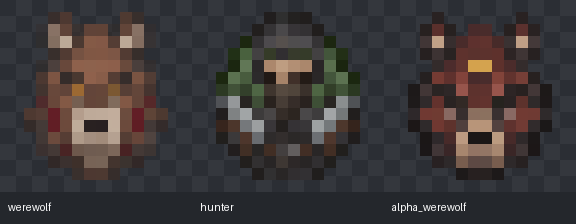

# Howling Werewolf — NeoForge 26.1.2

<p align="center">
  
</p>

<p align="center">
  <a href="https://github.com/R-Eatch/howling-werewolf/tree/v1.1.5"></a>
  
  
  
  <a href="LICENSE.md"></a>
  <a href="LICENSE-ASSETS.md"></a>
</p>

<p align="center"><a href="README.md">English</a></p>

> 当前分支提供 Minecraft 26.1.2 的 NeoForge 版；Minecraft 1.20.1 的 Forge 版维护在 [`1.20.1-forge`](https://github.com/R-Eatch/howling-werewolf/tree/1.20.1-forge) 分支。

Howling Werewolf 1.1.5 已完成基于 1.1.3 功能的 Minecraft 26.1.2 移植，使用稳定版 NeoForge 26.1.2.122 与 Java 25，并适配渲染、存档、配方、世界生成、持物动作和新版刷怪蛋美术。

Howling Werewolf 是一款独立开发的狼人变身与成长 Mod，内容围绕感染、月相变身、两套成长系统、三种狼人形态、猎人与银制品、狼毒草以及 Alpha 试炼展开。

## 环境要求

| 组件 | 版本 |
|---|---|
| Minecraft Java 版 | 26.1.2 |
| Mod 加载器 | NeoForge 26.1.2.122 或兼容的更高 26.1.2.x 版本 |
| Java | 25 |
| Howling Werewolf | 1.1.5 |

## 狼人皮肤

- 默认 **K** 打开狼人菜单 → **皮肤**，可选择原棕色 Adrian、琥珀眼灰狼 Ashen、金眼黑狼 Onyx、红眼白狼 Ivory；每套覆盖双足、四足和野兽三种形态。
- 预览支持鼠标跟随、拖动旋转、滚轮缩放和装备显示开关，点击应用后保存。预览不会解锁或切换实际形态。等级重置入口位于技能树列表下方。
- 皮肤选择会随玩家数据保存，死亡、换维度、重置等级、治愈后再觉醒均保留；第三人称、背包预览和第一人称爪使用同一套皮肤。
- 可在皮肤页创建绘画模板、打开资源包列表，启用自己的 PNG 皮肤；编辑后按 **F3 + T** 重载。详见[自定义皮肤教程](CUSTOM_SKINS-zh.md)（[English](CUSTOM_SKINS.md)）。

联机时服务端与客户端都需更新至 1.1.5。自定义皮肤只同步 ID，观察者需要启用相同资源包；缺少资源包时显示 Adrian，保存的选择仍保留。

## 刷怪蛋与持物动作



- 狼人和猎人刷怪蛋改为独立的 16×16 图标，与 Minecraft 26.1.2 的生物专属刷怪蛋风格同步。
- 新增 **月冠 Alpha 狼人刷怪蛋**，位于模组创造栏，物品 ID 为 `howlingwerewolf:alpha_werewolf_spawn_egg`。生成的是 Alpha 试炼使用的同一 Boss 实体；通过刷怪蛋单独生成不会绑定仪式，也不会发放仪式通关奖励。
- 普通狼人和野兽形态使用长矛时采用原版持矛准备动作；三叉戟使用独立的投掷蓄力姿势。

## 支持版本

- [Minecraft 1.20.1 · Forge](https://github.com/R-Eatch/howling-werewolf/tree/1.20.1-forge)
- [Minecraft 1.21.1 · NeoForge](https://github.com/R-Eatch/howling-werewolf/tree/1.21.1-neoforge)
- [Minecraft 26.1.2 · NeoForge](https://github.com/R-Eatch/howling-werewolf/tree/26.1.2-neoforge)：本分支，版本 **1.1.5**。

## 从源码构建

安装 Java 25 JDK 后运行：

```sh
./gradlew build -x test
```

Windows 使用 `gradlew.bat build -x test`。可分发 JAR 位于 `build/libs/howlingwerewolf-1.1.5-neoforge-26.1.2.jar`。

源码与 `v1.1.5` 标签维护于 GitHub；模组文件由维护者另外手动发布。更新 Mod 前请备份重要存档。

## 管理员命令

服务器管理员与测试人员可以查阅[管理员命令指南](ADMIN_COMMANDS-zh.md)，该文档也提供[英文版本](ADMIN_COMMANDS.md)。

## 许可证

源代码使用 [Mozilla Public License 2.0](LICENSE.md) 许可证。项目原创美术资源另行使用 [CC BY-SA 4.0](LICENSE-ASSETS.md) 许可证。署名与来源信息请参阅 [ASSET_PROVENANCE.md](ASSET_PROVENANCE.md) 和 [CREDITS.txt](CREDITS.txt)。
