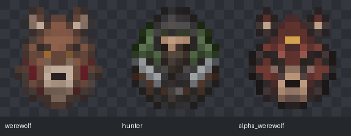

# Howling Werewolf — NeoForge 26.1.2

<p align="center">
  
</p>

<p align="center">
  <a href="https://github.com/R-Eatch/howling-werewolf/tree/26.1.2-neoforge"></a>
  
  
  
  <a href="LICENSE.md"></a>
  <a href="LICENSE-ASSETS.md"></a>
</p>

<p align="center"><a href="README-zh.md">简体中文</a></p>

> This branch contains the NeoForge edition for Minecraft 26.1.2. The Forge edition for Minecraft 1.20.1 is maintained on the [`1.20.1-forge`](https://github.com/R-Eatch/howling-werewolf/tree/1.20.1-forge) branch.

Howling Werewolf is an independently developed transformation and progression mod built around infection, lunar transformations, two progression systems, three werewolf forms, Hunters and Silver, Wolfsbane, the Alpha Trial and a pack of companions.

## What's new in 1.3.1

- **Attacks return to their 1.2.2 look.** The new claw strikes from 1.3.0 are withdrawn: the Werewolf, Beast and Quadruped swing one arm as they used to, first-person view is back to how it was, and companions, the Alpha and wild werewolves follow suit. Damage and attack cooldowns are unchanged.
- **Long Claws, Tool Claws and Fire Claws can be switched off.** Select one under **K** → Abilities and use **Turn off / Turn on** below it. They start on; switching costs and refunds nothing, can be undone at any time and is saved with the world.
- **Companions can be dismissed.** A **Dismiss** button below the orders on the Pack tab opens a separate confirmation page. A dismissed companion's record, tier and coat are gone, whatever it carries is handed back to you (anything that does not fit drops at your feet), and its slot is free again. Fallen and hunting companions can be dismissed too.
- **Stronger companions, shorter rest.** Attack by tier 0–3 is now 6, 8, 10 and 12, and the rest after each hunt drops from three Minecraft days to two.

## Earlier versions

- **1.3.0**: moonlit progression screen and companion window, hunt progress bars, item frames direct sorting, trapped chests and shulker boxes left alone, older-voiced dialogue, elbow fur fix.
- **1.2.7**: companions walk to containers and sort by hand; four-tab companion window; wolf-like Beast gallop; `/werewolf unlockalpha`.
- **1.2.6**: companion Sort order and Modern UV submission rework.
- **1.2.5**: **C** opens the companion window, right-click opens a companion, custom address, private dialogue.
- **1.2.3–1.2.4**: the companion system: altar merchants, badge-confirmed recruiting, nine-slot inventories, follow, guard, rest and hunt, cross-dimension recall, upgrades, revival, names and coats.
- **1.2.2**: Modern hand-held item anchors and the **Classic — By R_Eatch / Modern — By thewolfulti** credits. See the [1.2.2 changelog](docs/CHANGELOG-1.2.2.md).
- **1.1.8**: fixed-height Auto Step: 1.0 block for Quadruped, 1.5 for Werewolf, 2.0 for Beast. `gameplay.enableWerewolfAutoStep` defaults to `true`.

## Documentation

| Guide | Contents |
|---|---|
| [Companion guide](docs/COMPANIONS.md) ([简体中文](docs/COMPANIONS-zh.md)) | Summoning, recruiting, orders, sorting, hunting, settings |
| [Hunt and trade tables](docs/COMPANION-TABLES.md) ([简体中文](docs/COMPANION-TABLES-zh.md)) | Every hunt entry, tier factor and merchant trade |
| [Dialogue catalog](docs/COMPANION-DIALOGUE.md) | Every merchant and companion line in both languages |
| [Custom skins](CUSTOM_SKINS.md) ([简体中文](CUSTOM_SKINS-zh.md)) | Painting templates and skin resource packs |
| [Administrator commands](ADMIN_COMMANDS.md) ([简体中文](ADMIN_COMMANDS-zh.md)) | `/werewolf` for testers and server operators |
| [Architecture provenance](docs/COMPANION-PROVENANCE.md) | What the companion system drew on and how it differs |

## Requirements

| Component | Version |
|---|---|
| Minecraft Java Edition | 26.1.2 |
| Mod loader | NeoForge 26.1.2.122 or later compatible 26.1.2.x release |
| Java | 25 |
| Howling Werewolf | 1.3.1 |

## Werewolf skins

- Open the werewolf menu with **K** by default → **Skins**. Switch **Classic / Modern** in the upper-right corner, then select **Apply** to save. Classic retains Adrian, Ashen, Onyx and Ivory. Modern includes Ashen, Black, Chestnut, Pale, Rusty, Snowy, Spotted, Stripped and Woods. Each coat covers all three forms.
- New players default to **Modern / Ashen**. Existing Classic choices are preserved when upgrading.
- Preview with mouse tracking, drag rotation, scroll-wheel zoom, and an equipment toggle, then apply your selection. Previewing does not unlock or activate a form. Level Reset is in the lower band of the Skill Tree page.
- Modern camera height follows standing, crouching and quadrupedal sprinting. Weapons retain native size and palm anchors; armor and elytra follow the imported bones under the existing equipment rules.
- Your selection persists through death, dimension changes, level resets, and curing/reawakening. Third-person rendering, inventory previews, and first-person claws share the same skin.
- Create a painting template and open Resource Packs from the skin screen to enable your own PNG skins. Reload edits with **F3 + T**. See the [custom skin guide](CUSTOM_SKINS.md) ([简体中文](CUSTOM_SKINS-zh.md)).

Update both server and clients to **1.3.1** (protocol 19). Player model and coat choices are independent: when A selects Modern and B selects Classic, both clients render A with Modern and B with Classic. Built-in coats need no extra pack. Custom coats require the same resource pack on observing clients; a missing pack falls back to Adrian for Classic or Ashen for Modern while preserving the saved choice.

## NPC model configuration

In `config/howlingwerewolf-common.toml`:

```toml
[gameplay]
npcModelSet = "modern"
```

- `modern` (default): Alpha and its summoned pack use Ashen; wild and spawn-egg werewolves receive one of the nine saved coats.
- `classic`: the combat NPCs above use the Classic model and Adrian texture for their form.
- Merchants and companions follow this model setting too. Merchants choose random coats; recruited companions support renaming and skin selection, remembering separate Classic and Modern choices.
- Single-player uses the integrated server's config; multiplayer uses the dedicated server's config. Existing NPCs update after the config file reloads. Clients receive the model and coat through entity tracking, regardless of their own config. This setting does not change player-selected skins.

Merchants stay **10 minutes** and announce this when summoned. A Moonbane Pearl costs either **6 Wolfsbane + 1 Diamond** or **12 Emeralds + 4 Wolfsbane**. See the [dialogue catalog](docs/COMPANION-DIALOGUE.md).

## Companion settings and controls

Press **C** to manage companions, remappable in Controls; **Pack** at the top of the K screen leads there too. In the server's `config/howlingwerewolf-common.toml`:

```toml
[gameplay]
enableCompanions = true
enableCompanionSorting = true
```

`enableCompanions = false` parks companions and blocks interactions while keeping records and inventories and pausing hunt and cooldown timers. `enableCompanionSorting = false` turns off sorting alone. Multiplayer uses the server's setting. The [companion guide](docs/COMPANIONS.md) has the full rules.

The Moonlight or Nightfall choice is a personal preference, stored in `config/howlingwerewolf-client.toml`.

## Spawn eggs and item animations



- Werewolf and Hunter spawn eggs now use distinct 16×16 artwork following Minecraft 26.1.2's mob-specific egg style.
- The new **Moon-Crowned Alpha Werewolf Spawn Egg** is in the mod's creative tab and is available as `howlingwerewolf:alpha_werewolf_spawn_egg`. It spawns the same boss entity used by the Alpha Trial. A boss spawned this way is independent of the ritual and does not grant ritual completion rewards.
- Spear use now follows the native ready/holding animation in Werewolf and Beast forms. Tridents retain their separate throwing charge pose.

## Supported editions

- [Minecraft 1.20.1 · Forge](https://github.com/R-Eatch/howling-werewolf/tree/1.20.1-forge)
- [Minecraft 1.21.1 · NeoForge](https://github.com/R-Eatch/howling-werewolf/tree/1.21.1-neoforge)
- [Minecraft 26.1.2 · NeoForge](https://github.com/R-Eatch/howling-werewolf/tree/26.1.2-neoforge) — this branch, version **1.3.1**.

## Build from source

Install a Java 25 JDK, then run:

```sh
./gradlew build -x test
```

On Windows, use `gradlew.bat build -x test`. The distributable JAR is `build/libs/howlingwerewolf-1.3.1-neoforge-26.1.2.jar`.

Current source version is **1.3.1**, protocol 19.

The build passes, as do 21089 model, NPC and UI checks and 2704 artifact checks: compared with 1.3.0, only three companion guide passages changed and 15 keys were added, with every other line of text byte for byte the same. 793 native NeoForge server checks pass, first starting from the real save 1.3.0 left behind, then through a real restart. They cover dismissal (items handed back, dropped at the feet of an owner with a full inventory, fallen and hunting companions), the three claw switches (real damage, ignition and mining events, plus saving and sync) and the new cooldown and attack values. This version was not run in a real client: the restored attack animation, the dismissal page and the claw switches await the author's in-game review. It was not checked with Sodium, shader packs, claim plugins or two real clients.

## Administrator commands

Server operators and testers can consult the [administrator command guide](ADMIN_COMMANDS.md), also available in [Simplified Chinese](ADMIN_COMMANDS-zh.md).

## License

Source code is licensed under the [Mozilla Public License 2.0](LICENSE.md). Original project art is licensed separately under [CC BY-SA 4.0](LICENSE-ASSETS.md). See [ASSET_PROVENANCE.md](ASSET_PROVENANCE.md) and [CREDITS.txt](CREDITS.txt) for attribution and provenance.
