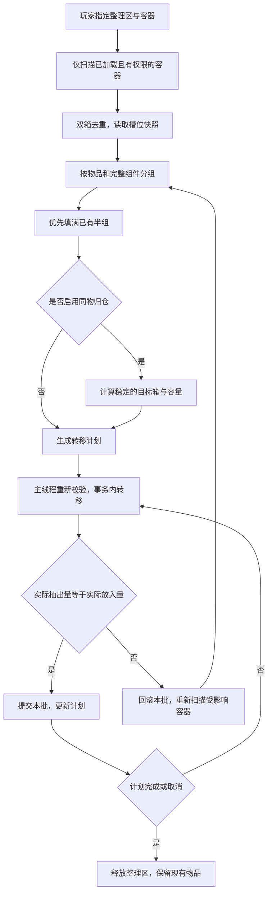

# 随从整理箱子设计稿

状态：**仅设计，未实装**。2026-11-03，面向 Minecraft 26.1.2 / NeoForge 26.1.2.122。没有添加整理按钮、状态、网络请求或任何库存搬运代码。

建议先做“合并半组”，验证稳定后再开放“同物归仓”。同物归仓也先保留箱内原有布局，仅搬动物品，不同时做按名称、模组、颜色等全量排序。

## 玩家看到的行为

玩家指定一个工作点，并逐个登记允许整理的箱子。建议默认水平八格、上下四格，最多二十四个逻辑容器，第一阶段支持原版箱子、双箱和木桶。只访问已加载区块，不为整理强制加载地形，不读取其他维度。

首版建议在工作点执行逻辑整理，不使用随从的九格背包中转。走到每个箱子搬运的动画可以后续增加；逻辑和表现分开，避免寻路失败留下半次搬运。

“合并半组”只把能叠加的零散物品凑成完整堆叠。“同物归仓”再把同种物品尽量集中到原本已经存放它的箱子里。满箱时保留在原处，不删除、不丢到地面。多次执行后应趋于稳定，不让物品来回换箱。

| 开始状态 | 合并半组后的结果 |
|---|---|
| 箱 A：32 铁锭；箱 B：32 铁锭 | 箱 A：64 铁锭；箱 B 的该格清空 |
| 箱 A：48 圆石；箱 B：48 圆石 | 箱 A：64；箱 B：32 |
| 箱 A：16 末影珍珠；箱 B：8 末影珍珠 | 不合成 24；遵守每组 16 的上限 |
| 两把耐久、附魔或名称不同的剑 | 不合并，也不改写它们的组件 |
| 双箱两半均被扫描到 | 作为一个逻辑容器处理一次，不重复搬运 |

## 什么算“同一种”

合并键使用“物品类型＋完整数据组件”，不把数量计入这个键。耐久、附魔、自定义名称、药水、书本、内部容器内容等不同，就分为不同组。不可叠加物品保持单件，不把同 ID 的工具硬合成一堆。

NeoForge 26.1 的 `ItemResource` 用来表示不含数量的物品与组件身份；本项目 26.1.2.122 依赖也包含该接口。由它进行相等性判断，比自行拼接物品 ID 或 NBT 文本合适。[官方事务与 Resource 说明](https://docs.neoforged.net/docs/inventories/transactions/)。

哈希仅用于加速分组，最终仍按完整资源相等性确认。目标格容量取物品堆叠限制、容器格限制和插入规则共同允许的数量，不能统一当成 64。

## 算法：扫描、分组、规划、分批提交



1. **扫描**：读取登记且在范围内的容器，记录维度、坐标、逻辑容器 ID、槽位、资源、数量、容量和访问限制。双箱 ID 用两半坐标中的稳定较小者，两半都可用时才纳入。
2. **分组**：建立 `资源 → 已有完整堆叠、半组、可用目标格` 的索引。空格另记，避免对每一种物品重复扫描全部箱子。
3. **合并半组**：按确定顺序填目标格，先处理更接近满组的目标；同等条件依次比较指定优先级、到工作点距离、坐标和槽号。抽取端从较小半组开始，优先腾出完整空格。
4. **可选归仓**：对每种资源优先选择已经存放该物品、且有容量的目标箱。目标由玩家指定优先级决定，其次考虑已有同物数量，再按距离和坐标打破平局。已经选好的目标在本次任务内固定，避免某一批搬完后因“数量最多”变化而反向搬回。
5. **容量预留**：在规划快照里扣除所有已分配的空格，不让两种物品预订同一格。某物品放不下，就保留剩余堆叠，不把其他物品移来移去强行腾格。
6. **执行**：每次真正移动前重新读取源、目标及权限。玩家、漏斗或其他模组改过相关格子时，废弃受影响的小计划并重新规划，不能照旧快照覆盖整个箱子。

若扫描到 S 个槽位，分组平均 O(S)，稳定排序约 O(S log S)，执行约 O(T)，T 为实际转移次数。避免为每个物品堆逐一寻找所有箱子的 O(S²) 做法。组件哈希也有成本，应缓存本次快照结果并在槽位变化后失效。

## 库存转移建议

本项目版本实际提供 `Capabilities.Item.BLOCK`、`ResourceHandler<ItemResource>` 和 `Transaction`。先通过容器能力取得访问接口，尊重侧面、槽位及自动化限制；后续扩展模组箱子时继续用能力接口，不直接修改它们的私有 NBT。[官方能力接口](https://docs.neoforged.net/docs/inventories/capabilities/)。

以下是设计伪代码，未写入 Mod：

```text
每批移动前：
    校验主人权限、整理区、两端容器身份、两端最新槽位
    确认资源完全相等，计算本批最大允许数量

在一个短事务中：
    从源格抽出 n
    向目标格放入同一资源，得到 m
    只有 n > 0 且 m == n 才提交
    否则结束事务并回滚整批
```

建议以同一个根事务包住本次抽出和放入，失败时放弃整批；不要先把箱子清空，再根据全局快照重新填满。NeoForge 的事务用于这类库存转移，未提交时可以恢复参与者的运行时状态。[官方事务机制](https://docs.neoforged.net/docs/inventories/transactions/)。

不能把内存事务描述成“任意断电下跨区块存档绝对原子”。若要承诺崩溃后的严格一致性，还需要持久转移记录、容器提交标记、恢复流程与故障注入检查；首版应先限定经过验证的原版容器，明确兼容范围。

## 多人、并发与中断

- 原版箱子没有通用的玩家所有权信息，附近不等于主人拥有。建议使用主人逐个登记的白名单，并在执行时检查锁、领地及服务器访问规则；未接入的保护模组默认拒绝自动化。
- 同一个逻辑容器同一时刻只归一个整理任务使用。由服务端以维度和逻辑容器 ID 管理短期占用，多名随从不能同时重复执行同一计划。
- 玩家正在查看的箱子默认跳过。漏斗和其他自动化仍可能改变库存，因此即使没有玩家开箱，每批也必须重读校验。
- 离线、死亡、狩猎、召回、关闭功能、区块卸载、箱子被破坏或权限变化时，中止未提交事务并释放占用。重新开始时重新扫描，不复用旧槽号。
- 任务保存在主人与随从绑定的档案中，运行时容器引用和占用不跨重启保存。恢复的是工作点与规则，重启后重建计划。
- 第一版不处理末影箱、玩家背包、随从背包、潜影盒内部递归、熔炉/酿造台等加工容器，也不绕过单向槽或把无法放下的物品扔出去。

## 性能和玩法建议

先建议每游戏刻最多移动四个堆叠，并设一个小的服务端时间预算；实际参数需压测后确定。容器列表在任务开始及变化时更新，不每刻重扫周围所有方块。

整理与狩猎互斥；主人可以随时取消或召回。受攻击时建议先中止未完成整理，再按预先设定的守护/休息策略处理。具体成长加成、半径、速度、消耗和整理模式名称尚未定案。

## 实装前需要验证

半组、满箱、16 堆叠上限、不可叠加物品、不同组件、双箱、未加载区块、锁与领地、玩家与漏斗同时改物品、两名随从争用、取消/死亡/重启、模组容器拒绝抽出或只接收部分数量，以及执行第二次不再来回搬运。

验收核心是每种完整资源的总量守恒、组件不变、每格不超限、没有权限外访问；异常时保留可追踪的原物品，不以丢地上作为默认兜底。
